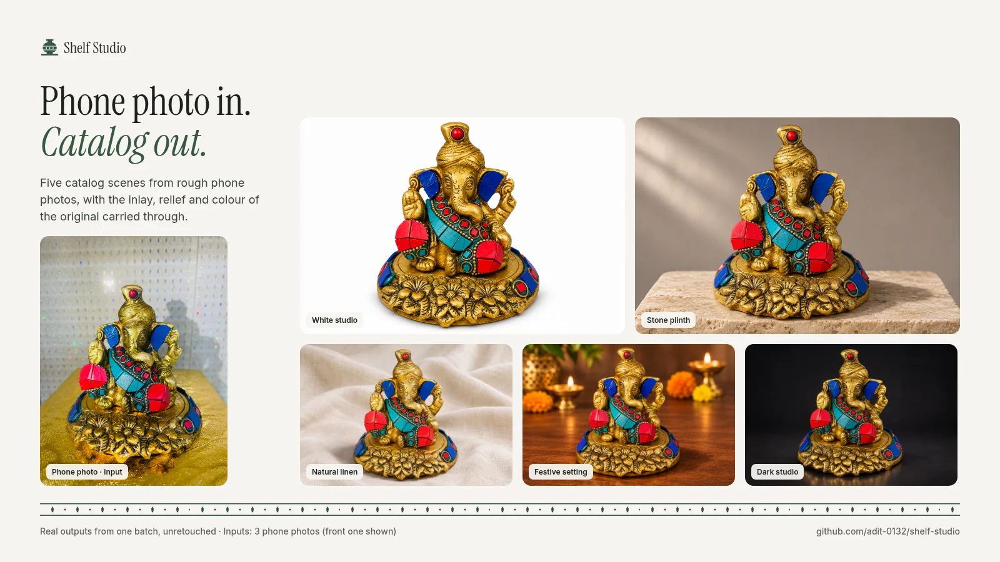
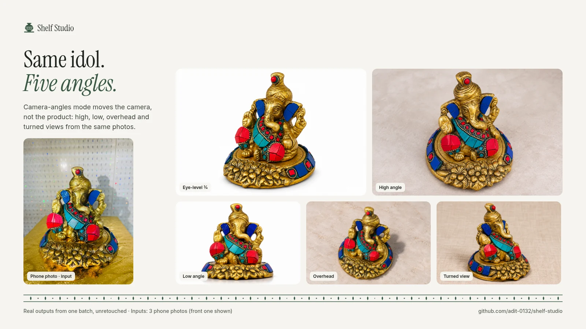
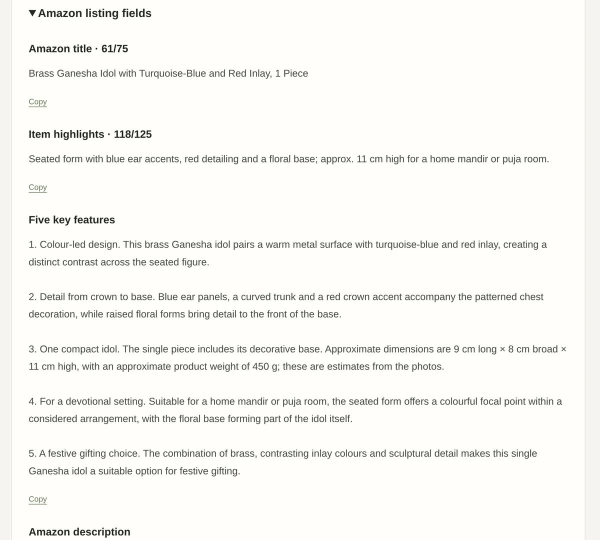
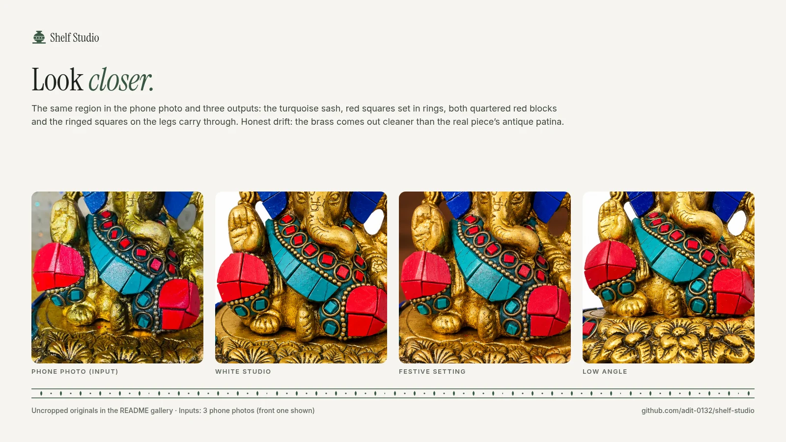
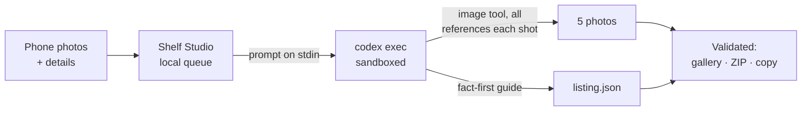
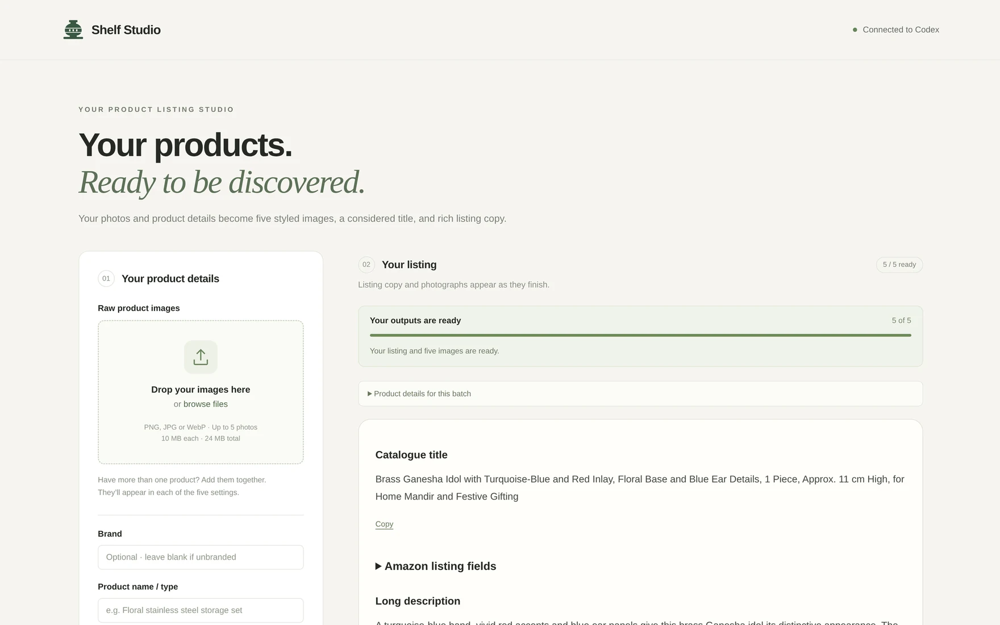

<p align="center">
  <picture>
    <source media="(prefers-color-scheme: dark)" srcset="docs/brand/final/lockup-ondark.svg">
    
  </picture>
</p>

<p align="center">
  <b>Phone photo in. Catalog out.</b><br>
  Catalog-style product photos and marketplace listing copy, made on your own machine with the Codex CLI.
</p>

<p align="center">
  <a href="LICENSE"></a>
  
  
  
</p>

<p align="center">
  <a href="#get-started">Get started</a> ·
  <a href="SETUP.md">Setup guide</a> ·
  <a href="#how-it-works">How it works</a> ·
  <a href="#limits-honestly">Limits</a>
</p>



<p align="center"><sub>Real outputs from one batch, unretouched. Inputs: three phone photos taken in a shop (front one shown).</sub></p>

Small sellers photograph products where they stand: on a shop shelf, in front of glitter wallpaper, with their own
shadow in the frame. Shelf Studio turns those photos into clean catalog shots and the listing copy to go with them.
It is built around **fidelity**:

- **Every image generation call gets all of your reference photos.**
- **Strict instructions to keep the real object:** its exact shape, proportions, piece count, colours and decorative
  detail (engraving, inlay, printed patterns). Only the setting, the light or the camera angle changes.
- **Listing copy that refuses to make things up.**

It runs on your computer, through the image generation built into your [Codex CLI](https://github.com/openai/codex)
sign-in. There is no API key, no separate sign-up and no server of its own.

## What it makes

### Five scenes

The same view, in five settings and lighting moods.

| Scene | Look |
|---|---|
| White studio | Seamless white, soft contact shadows, no props |
| Stone plinth | Travertine plinth, warm-grey backdrop, soft directional window light |
| Natural linen | Light linen with soft folds, bright diffused daylight |
| Festive setting | Warm walnut with softly blurred marigolds and brass diyas, warm glow |
| Dark studio | Charcoal backdrop, low-key light with rim highlights on edges and texture |

### Five camera angles



The camera moves; the product stays the same. The settings are kept plain, so the viewpoint is what varies.

| View | Camera and setting |
|---|---|
| Eye-level ¾ | Product height, turned about 30°; white studio |
| High angle | About 45° above, looking down; soft-daylight tabletop |
| Low angle | Near the base looking up about 10°; white seamless |
| Overhead | Steeply above, about 65°; pale stone |
| Turned view | Orbited about 60° around the product; natural linen |

New viewpoints can show parts that no reference photo shows, such as interiors, backs or bases. The prompt keeps those
plain and tells the model never to invent new ornament, so send photos from several sides when you can.

### Listing copy



Every batch also writes the listing, checked against marketplace limits:
- a catalogue title (up to 220 characters),
- an Amazon title (up to 75) and Item Highlights (up to 125),
- five feature bullets,
- an Amazon description (up to 2,000) and a longer store description,
- a specification table built from your exact inputs.

The copy follows a fact-first writing guide (`knowledge/`). It never infers grade, purity, plating, capacity, safety
or origin from a photo, and it never invents a brand. Review notes flag missing or conflicting facts, and they stay
out of the customer-facing text. Everything downloads as one ZIP.

## Look closer



These are the same region of the idol in the phone photo and in three outputs. The turquoise sash, the red squares set
in rings, both quartered red blocks and the ringed squares on the legs carry through. The drift is visible too: the
brass comes out cleaner than the real piece's antique patina. That is the honest shape of generative fidelity, and
why the app tells you to review before you publish.

## How it works



For each batch the server runs:

```sh
codex exec --json --skip-git-repo-check --sandbox workspace-write \
  -C data/<batch-id> --output-last-message data/<batch-id>/response.txt -
```

- **The prompt goes in on stdin**, and the arguments are passed without a shell.
- **Codex writes only inside that batch's folder** (`outputs/<scene>.png` and `outputs/listing.json`).
- **The app validates every file before showing it**, and a batch times out after 30 minutes.
- **Every batch keeps its exact prompt** in `request.txt`, so you can always see what was asked.

## Get started

You need **Node.js 22+** (no npm dependencies) and the **Codex CLI**, signed in with a ChatGPT plan that includes
image generation. Generation counts against that plan's usage limits.

```sh
npm install -g @openai/codex    # tested with codex-cli 0.156.1
codex login                     # sign in with your ChatGPT account

git clone https://github.com/adit-0132/shelf-studio.git
cd shelf-studio
npm start                       # then open http://localhost:4317
```

The header should say **Connected to Codex**. For step-by-step setup with a check at each step, a way to confirm that
Codex's image tool is available, and troubleshooting, see **[SETUP.md](SETUP.md)**. It is written for people and for
coding agents setting the app up on someone's behalf.

## Using it



1. Drop 1–5 photos of your product (PNG, JPEG or WebP; 10 MB each, 24 MB total). Several angles of the same product
   help, and several different products appear together in every shot.
2. Optionally add the brand, product name or type, material, number of pieces, per-piece dimensions and weights, and
   comments. Comments mainly steer the copy (tone, care instructions, extra specs). Photo requests apply only when you
   ask for them explicitly.
3. Under **Photo set**, choose **Five scenes** or **Five camera angles**, then click **Generate complete listing**.
   Copy and images appear as they finish, usually within a few minutes.

Batches persist across restarts:
- **Retry** creates only the missing outputs.
- **Stop** keeps finished images.
- A batch interrupted by a restart waits for you to resume it, so nothing is charged twice automatically.

**Use as a writing example** saves a listing's style (never its facts) to guide the tone of later listings.

## Limits, honestly

- **It redraws the product.** The image model re-renders the whole photo rather than cutting out your original.
  - Fine patterns and small lettering can drift, and finishes can come out cleaner than the real piece.
  - Review every image before you publish.
- **The Amazon main image must be a real photo of the product.** Treat the white-studio shot as a clean secondary
  image unless your marketplace's rules say otherwise.
- **Unseen sides are approximations** in camera-angles mode. "Overhead" tends to come out closer to a high angle than
  the 65° it asks for.
- **It needs a paid ChatGPT plan with Codex image generation**, and images use that plan's limits faster than text
  does.
- **It is local by design.** It listens on `127.0.0.1` only, so it can't be shared on a network or used from a phone.

## Configuration

| Variable | Default | Purpose |
|---|---|---|
| `PORT` | `4317` | Local port. The server only binds `127.0.0.1`. |
| `STUDIO_DATA_DIR` | `./data` | Where batches are stored. |
| `STUDIO_KNOWLEDGE_DIR` | `./knowledge` | Writing guide to use. See [knowledge/README.md](knowledge/README.md) for making a brand or category pack. |
| `CODEX_BIN` | `codex` on `PATH` | Path to the Codex CLI. |
| `CODEX_MODEL` | your Codex default | Model for this app only, e.g. `CODEX_MODEL=gpt-6-luna npm start`. |

If a batch fails with `model_not_found`, the default model in `~/.codex/config.toml` isn't available to your account.
Set `CODEX_MODEL` to one that is.

If listing copy arrives but no images do, your Codex session didn't expose the built-in image tool. Check
`response.txt` in the batch folder. Make sure your plan includes image generation, then sign in again with
`codex logout && codex login`.

## Run at login (Linux, optional)

```sh
./linux/install.sh                          # or: CODEX_MODEL=<model> ./linux/install.sh
```

This installs a systemd user service and a **Shelf Studio** app-menu launcher for this clone. Re-run it after moving
the folder. To remove it:

```sh
systemctl --user disable --now shelf-studio
rm ~/.config/systemd/user/shelf-studio.service ~/.local/share/applications/shelf-studio.desktop
```

## Project layout

```
src/
  server.mjs      HTTP server, persistent job queue, Codex runner
  scenes.mjs      scene and camera-angle presets, and the product-preservation prompt
  listing.mjs     listing schema, limits, validation and copy prompt
  knowledge.mjs   loads the writing guide; frozen snapshot per batch
  zip.mjs         dependency-free ZIP writer
public/           the web UI and example images
knowledge/        brand- and category-neutral writing guide
docs/brand/       logo, palette, type and the scripts that build them
docs/images/      README images
linux/            optional systemd service and launcher installer
test/             node:test suite
data/             your batches (created at runtime, gitignored)
```

Each batch folder holds:
- `inputs/`: your photos,
- `outputs/`: the PNGs and `listing.json`,
- `request.txt` and `response.txt`,
- `job.json`: the batch state,
- `knowledge-snapshot.json`: the guide version used.

## Tests

```sh
npm test
```

The tests cover:
- upload validation and local-only request guards,
- progress, completion and ZIP export,
- partial failure, retry, cancellation and queue order,
- restart recovery and symlink protection,
- listing validation,
- both photo sets,
- the favicon.

They use temporary folders and a stub runner, so they never call Codex or generate images.

## Security notes

Shelf Studio is a personal local tool, not a hosted service. It listens on `127.0.0.1` only, and it rejects foreign
`Host` and `Origin` headers. POSTs require a per-session token, and pages are served with a strict Content Security
Policy. It never reads or exposes your Codex credentials.

## Credits and license

- **Code:** [GPL-3.0-or-later](LICENSE).
- **Brand:** the logo, palette and type are documented in [docs/brand](docs/brand/README.md). The wordmark uses
  Instrument Serif (SIL Open Font License).
- **Example images:** the app's built-in examples and the images above come from the same three phone photos of the
  author's own product.

Shelf Studio is an independent project. It is not affiliated with or endorsed by OpenAI, Amazon or Flipkart.
